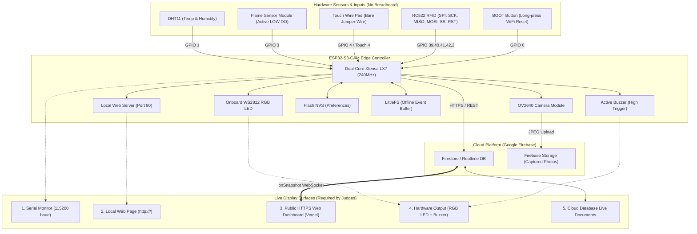
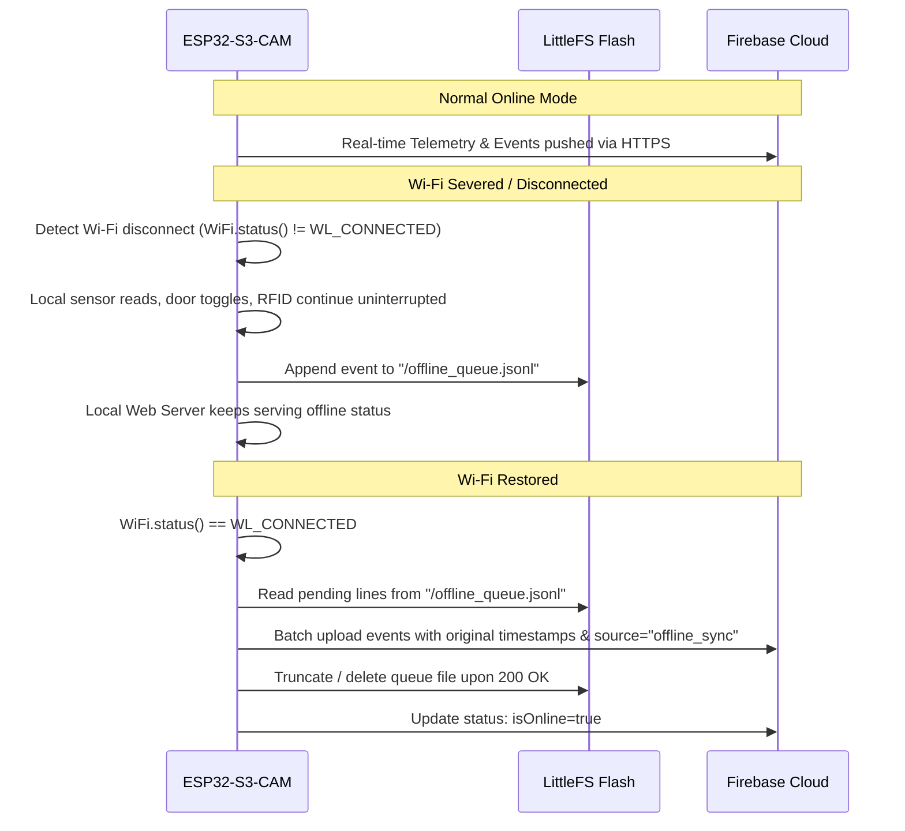

# Architecture & Pin Mapping — AI-Powered Smart Classroom

## 1. System Architecture Diagram



---

## 2. Hardware Pin Mapping & Power Distribution (No Breadboard Solution)

### 2.1 Pin Assignment Table (Optimized for ESP32-S3-CAM)
Because the OV2640 camera uses internal DVP bus pins (typically GPIO 4, 5, 6, 7, 15, 16, 17, 18, 8, 9, 10, 11, 12, 13, 14 depending on the camera board variant), we select peripheral pins that **do not conflict** with camera streaming.

| Peripheral | Board Pin | Function | Electrical Level |
|---|---|---|---|
| **RC522 SPI SCK** | **GPIO 39** | Serial Clock | 3.3V Logic |
| **RC522 SPI MISO** | **GPIO 40** | Master In Slave Out | 3.3V Logic |
| **RC522 SPI MOSI** | **GPIO 41** | Master Out Slave In | 3.3V Logic |
| **RC522 SPI SS / SDA** | **GPIO 42** | Chip Select | 3.3V Logic |
| **RC522 RST** | **GPIO 2** | Hardware Reset | 3.3V Logic |
| **DHT11 Data** | **GPIO 1** | Single-bus data line | 3.3V / 5V |
| **Flame Sensor DO** | **GPIO 3** | Digital Output (LOW = Fire) | 3.3V / 5V |
| **Touch Panic Pad** | **GPIO 4 / T4** | Exposed jumper metal tip | Touch capacitive sensing |
| **Active Buzzer** | **GPIO 38** | Audio alarm trigger (HIGH = Beep) | 3.3V / 5V |
| **Onboard RGB LED** | **GPIO 48** | Built-in WS2812 NeoPixel | Internal |
| **BOOT Button** | **GPIO 0** | Long press (5s) = WiFi Factory Reset | Internal |

*(Note: In `config.h`, all pins are `#define` macro constants, allowing 10-second remapping if your specific on-site board utilizes alternate pins).*

### 2.2 Power & Ground Splitting Without a Breadboard
- **VCC (3.3V / 5V) & GND:** You have 3 sensors + RFID + Buzzer that require power and ground.
- **T-Splice Jumper Technique:** Daisy-chain female-to-female jumper wires by plugging a male jumper pin partially into the side of a female connector, or twisting exposed male pin headers together and insulating with electrical tape.
- **RC522 VCC:** Strictly connect to **3.3V** pin (5V will damage the MFRC522 chip).

---

## 3. Simulated Door State Machine & Hardware Indicators

The classroom door has no physical motor. Its state is simulated in memory and persisted in NVS:

| Door State | RGB LED (GPIO 48) | Buzzer Response | Local Status Page | Web Dashboard |
|---|---|---|---|---|
| **LOCKED** | Solid RED | 1 short high beep upon locking | Red badge: `LOCKED` | Red card: `LOCKED` |
| **UNLOCKED** | Solid GREEN | 2 short beeps upon unlocking | Green badge: `UNLOCKED` | Green card: `UNLOCKED` |
| **FIRE EMERGENCY** | Flashing RED / ORANGE | Continuous sirens (200ms on/off) | Blinking: `FIRE EVACUATION` | Floating red alert banner |
| **PANIC ALARM** | Pulsing MAGENTA | SOS Morse Code beeps | Blinking: `PANIC TRIGGERED` | Orange panic alert banner |
| **INTRUDER / DENIED** | 3 quick RED flashes | 3 harsh rapid beeps | `UNAUTHORIZED ACCESS` | Warning badge with log |

---

## 4. Cloud Database Schema (Firebase Firestore)

```
/rooms/{roomId}/
  ├── status (Document)
  │     ├── doorState: "LOCKED" | "UNLOCKED"
  │     ├── temperature: 27.8
  │     ├── humidity: 62.0
  │     ├── flameDetected: false
  │     ├── panicActive: false
  │     ├── wifiRSSI: -48
  │     ├── lastSeen: Timestamp
  │     ├── isOnline: true
  │     └── activeAlert: null | "FIRE" | "PANIC" | "INTRUDER"
  │
  ├── config (Document)
  │     ├── tempThresholdHigh: 40.0
  │     ├── buzzerEnabled: true
  │     ├── autoLockTimeoutSec: 15
  │     ├── faceDetectionEnabled: true
  │     └── updatedAt: Timestamp
  │
  ├── events (Collection)
  │     └── {eventId} (Document)
  │           ├── type: "rfid_student" | "rfid_teacher" | "fire_alarm" | "panic_pad" | "door_state" | "intruder" | "offline_sync"
  │           ├── timestamp: Timestamp
  │           ├── details: "Student Check-in: Card UID A1B2C3D4"
  │           ├── cardUID: "A1:B2:C3:D4"
  │           ├── personName: "Student White Card"
  │           ├── photoURL: "https://storage.googleapis.com/..."
  │           └── source: "esp32" | "dashboard"
  │
  └── attendance (Collection)
        └── {YYYY-MM-DD} (Document)
              └── records (Collection)
                    └── {cardUID} (Document)
                          ├── studentName: "Student White Card"
                          ├── checkInTime: Timestamp
                          ├── method: "RFID" | "Face" | "Both"
                          └── photoURL: ""
```

---

## 5. Offline Resilience Architecture (Level 11)


