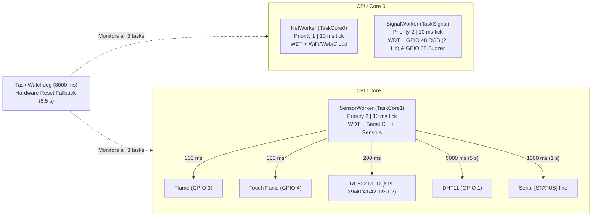

# FastRobox 1.0 Techathon (BUBT) — Level 1 Write-up

- **Team ID:** `16`
- **Team Name:** `BUBT GAMA`
- **Device ID:** `16-D1`
- **Level:** Level 1 — Dual-Core Tasks, Health and Watchdog (35 marks)
- **Repository:** `https://github.com/Nibir-Ahmed/hackathon-BUBT-GAMA-16`
- **Latest Commit:** `e5e861c`

---

## 1. Design

The firmware runs on an **ESP32-S3-N16R8 CAM** using three pinned FreeRTOS tasks split across **both CPU cores**, non-blocking sensor polling and Serial CLI handling, a single-owner priority-based RGB/buzzer controller (`DeviceSignalsManager`), and an 8-second Task Watchdog Timer (`esp_task_wdt`) with a clean hardware-reset ISR/fallback so any task freeze restarts the board within 10 seconds.

### Wiring Diagram (Every Pin Connection)

| Component | Module Pin | ESP32-S3-CAM Pin | Notes |
|---|---|---|---|
| **RC522 RFID** | `VCC` | `3.3V` | 3.3V power |
| **RC522 RFID** | `GND` | `GND` | Ground |
| **RC522 RFID** | `RST` | `GPIO 2` | Reset |
| **RC522 RFID** | `MISO` | `GPIO 40` | Custom SPI MISO |
| **RC522 RFID** | `MOSI` | `GPIO 41` | Custom SPI MOSI |
| **RC522 RFID** | `SCK` | `GPIO 39` | Custom SPI Clock |
| **RC522 RFID** | `SDA (SS)` | `GPIO 42` | SPI Chip Select |
| **DHT11** | `VCC` / `GND` / `DATA` | `3.3V` / `GND` / `GPIO 1` | Read every `5 s` |
| **Flame Sensor** | `VCC` / `GND` / `DO` | `3.3V` / `GND` / `GPIO 3` | Active LOW, read every `100 ms` |
| **Active Buzzer** | `(+) long leg` / `(-) short leg` | `GPIO 38` / `GND` | Driven by `SignalWorker` |
| **Touch Panic Pad** | `Jumper tip` | `GPIO 4` (`T4`) | Capacitive touch channel 4 |
| **WS2812 RGB LED** | Onboard DIN | `GPIO 48` | No external wiring |
| **BOOT Button** | Onboard Active LOW | `GPIO 0` | No external wiring |

### Task Architecture & Task Diagram

| Task Name | Function | CPU Core | Priority | Stack | Loop Tick / Periods | Responsibilities |
|---|---|---|---|---|---|---|
| `NetWorker` | `TaskCore0` | **Core 0** | `1` | `8192 B` | `10 ms` tick | Feeds Task WDT; runs Wi-Fi portal, HTTP server, and cloud queue (when `ENABLE_LEVEL_2_WIFI = 1`) |
| `SignalWorker` | `TaskSignal` | **Core 0** | `2` | `4096 B` | `10 ms` tick (`250 ms` LED toggle = `2 Hz`) | Feeds Task WDT; sole owner of `GPIO 48` RGB LED and `GPIO 38` buzzer |
| `SensorWorker` | `TaskCore1` | **Core 1** | `2` | `8192 B` | `10 ms` tick | Feeds Task WDT; Flame (`100 ms`), Touch (`100 ms`), RFID (`200 ms`), DHT11 (`5000 ms`), `[STATUS]` (`1000 ms`), non-blocking Serial CLI |



### Start-up, Watchdog & Sensor Error Behavior
- **Flame at start-up:** `setup()` reads `GPIO 3` (`sensors.readFlame()`) before starting tasks. No flame → `door=LOCKED`; flame detected at boot → `door=UNLOCKED` (`[EVENT] FIRE Flame at startup -> Door UNLOCKED`).
- **Task Watchdog (`hang`):** All 3 tasks register with `esp_task_wdt`. Typing `hang` freezes `SensorWorker` (`deliberateHang = true`), writes `0x57445431UL` to `RTC_NOINIT_ATTR rtcWdtHangMagic`, triggers a hardware reset via `esp_task_wdt_isr_user_handler` (`REG_SET_BIT(RTC_CNTL_OPTIONS0_REG, RTC_CNTL_SW_SYS_RST)`) within `<= 8.5 s`, and prints `[EVENT] BOOT reason=WATCHDOG` with `door=LOCKED`.
- **Sensor unplug detection:**
  - **RFID (`<= 3 s`):** Polled every `200 ms`; if `isReaderConnected()` fails for `>= 2000 ms`, prints `[ERROR] SENSOR ERROR: RFID` and switches RGB LED to Magenta `2 Hz`. Auto-clears on reconnect.
  - **DHT11 (`<= 12 s`):** Polled every `5000 ms`; if reads fail for `>= 9000 ms`, prints `[ERROR] SENSOR ERROR: DHT11` and switches RGB LED to Magenta `2 Hz`. Auto-clears on reconnect.

---

## 2. Where It Shows

- **Serial Monitor (`115200` baud):**
  - `[EVENT] BOOT reason=POWER_ON` (or `WATCHDOG` after `hang`)
  - `[STATUS]` printed every `1 s` in the fixed format:
    ```text
    [STATUS] up=75s T=23.9C RH=59% HI=23.9C flame=0 door=LOCKED state=SAFE trend=STABLE rssi=- heap=274k psram=8189k chip=31.9C fw=1.0.0
    ```
  - `[CARD] uid=<UID> role=<ROLE>` printed **once per tap** (with `PICC_HaltA()` + `800 ms` same-UID cooldown)
  - `[ERROR] SENSOR ERROR: RFID` / `[ERROR] SENSOR ERROR: DHT11` when unplugged, clearing when reconnected
  - Replies to `help`, `status`, `health`, `tasks`, `ver`, and `hang`
- **Light and Buzzer:**
  - **Green `2 Hz`** (`250 ms` ON / `250 ms` OFF) when Safe (and Wi-Fi connected / Level 1 standalone)
  - **Magenta `2 Hz`** while any sensor error (`RFID` or `DHT11`) is active

---

## 3. Test Results

| Check / Test Item | Type | Measured Value | Spec Limit | Result |
|---|---|---|---|---|
| RGB LED heartbeat + 3 taps + 5 s hold | Live (Row A1) | `2 Hz` steady; `3` + `1` `[CARD]` lines | `2 Hz`; 1 line/tap | **PASS** (Att. 1) |
| `health` & `tasks` Serial commands | Live (Row A1) | All health fields; 3 tasks on Core 0 & Core 1 | Required | **PASS** (Att. 1) |
| `hang` → Watchdog reboot | Live (Row A2) | `<Fill measured seconds, <= 10 s>` | `<= 10 s`, `BOOT reason=WATCHDOG`, `door=LOCKED` | `<Verify Att. 2>` |
| RC522 SDA unplugged 15 s | Video | `~2.0–2.2 s` (`[ERROR] SENSOR ERROR: RFID`, Magenta) | `<= 3 s` | `<Fill video timestamp>` |
| DHT11 DATA unplugged 15 s | Video | `~9–10 s` (`[ERROR] SENSOR ERROR: DHT11`, Magenta) | `<= 12 s` | `<Fill video timestamp>` |
| Both sensors reconnected | Video | Auto-cleared to Green `2 Hz` | Auto-clear | `<Fill video timestamp>` |
| Flame at boot → `door=UNLOCKED` | Write-up | `GPIO 3` LOW at boot sets `door=UNLOCKED` | `UNLOCKED` | **Implemented in `setup()`** |

---

## 4. Problems and Fixes

1. **ESP32-S3 Watchdog `abort()` halted on USB-CDC instead of rebooting:**
   - *Symptom:* Typing `hang` triggered `task_wdt: Aborting.` and froze the LED indefinitely instead of restarting within `10 s`.
   - *Fix:* Configured `trigger_panic = false` (`esp_task_wdt_init(..., false)` / `esp_task_wdt_reconfigure`), implemented `esp_task_wdt_isr_user_handler()` with `REG_SET_BIT(RTC_CNTL_OPTIONS0_REG, RTC_CNTL_SW_SYS_RST)` + `RTC_NOINIT_ATTR rtcWdtHangMagic`, added an `8.5 s` hardware reset fallback in `hang`, and printed `[EVENT] BOOT reason=<reason>` in `setup()`.
2. **RC522 custom SPI pin mismatch on ESP32-S3:**
   - *Symptom:* `MFRC522` initialized the default SPI pins instead of `SCK=39, MISO=40, MOSI=41, SS=42, RST=2`.
   - *Fix:* Explicitly initialized `SPI.begin(39, 40, 41, 42)` before `mfrc522.PCD_Init()`, and added `PICC_HaltA()` + `800 ms` cooldown for clean single-line `[CARD]` output.
3. **Non-blocking Serial CLI & single-owner RGB/Buzzer control:**
   - *Symptom:* Blocking Serial reads or multiple tasks writing GPIO 48/38 caused jitter on the `2 Hz` heartbeat.
   - *Fix:* Replaced blocking reads with a character buffer in `TaskCore1` and isolated GPIO 48/38 inside `SignalWorker` (`DeviceSignalsManager`) protected by `portMUX_TYPE`.

---

## 5. Extra Items (Required by Level 1 Write-up Spec)

- **Fixed `[STATUS]` line every `1 s`:**
  ```text
  [STATUS] up=75s T=23.9C RH=59% HI=23.9C flame=0 door=LOCKED state=SAFE trend=STABLE rssi=- heap=274k psram=8189k chip=31.9C fw=1.0.0
  ```
- **Confirmed sensor read periods (from `config.h` & `firmware.ino`):**
  - **DHT11:** `5 s` (`DHT_READ_INTERVAL_MS = 5000`)
  - **Flame sensor:** `100 ms` (`FLAME_READ_INTERVAL_MS = 100`)
  - **RFID reader:** `200 ms` (`RFID_POLL_INTERVAL_MS = 200`)
- **Flame at start-up:** Booting with flame active on `GPIO 3` sets `door=UNLOCKED` immediately in `setup()`.
