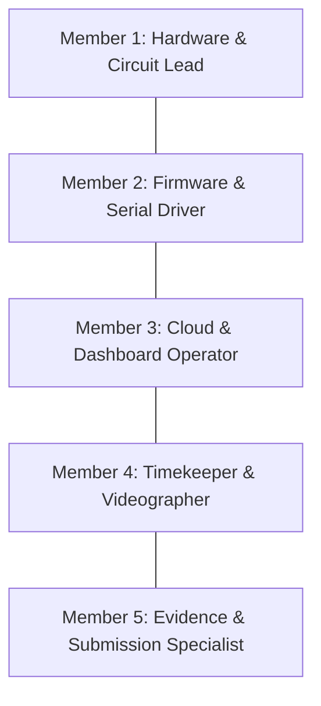

# 5-Member Team Role Matrix & Hackathon Game Plan

## 1. Team Roster & Assigned Responsibilities



### Member 1: Hardware & Circuit Lead
- **Tooling:** Jumper wire set, insulating tape, paper box/book for camera mount.
- **Tasks:**
  1. Inspect the provided ESP32-S3-CAM board pins immediately upon receipt.
  2. Wire the 5 external modules (RC522, DHT11, Flame sensor, Buzzer, Touch wire) using pin-to-pin jumpers without breadboard.
  3. Ensure solid 3.3V and GND connections (daisy-chained securely).
  4. Angle the camera towards the test subjects (team members).
  5. Check physical stability so wires never disconnect when testing or showing to judges.

### Member 2: Firmware & Serial Driver (Primary Judge Communicator)
- **Tooling:** Arduino IDE, high-speed Data USB Cable.
- **Tasks:**
  1. Flash `firmware.ino` to the board.
  2. Keep Serial Monitor open at **115200 baud** with Auto-Scroll active.
  3. Demonstrate live tests to the judges calmly and methodically.
  4. Perform on-the-spot Wi-Fi connection via phone Captive Portal (`SmartClassroom-Setup`).
  5. Guide the team through the 3 pre-call rehearsal tests.

### Member 3: Cloud & Web Dashboard Operator
- **Tooling:** Laptop with live HTTPS Dashboard open, phone hotspot, Firebase Console.
- **Tasks:**
  1. Keep the public HTTPS dashboard open on screen.
  2. Verify real-time Firebase sync (door status, temp/humidity, alerts, attendance).
  3. Demonstrate remote configuration changes (e.g. temperature threshold slider).
  4. Maintain phone hotspot as primary or backup network.

### Member 4: Timekeeper & Videographer
- **Tooling:** Smartphone with 720p/1080p camera on a mini-tripod/stand, digital stopwatch.
- **Tasks:**
  1. Before every judge call, run the stopwatch during rehearsals to ensure actions finish within time limits.
  2. Record the official judging videos for each level.
  3. Clearly announce at the start of every clip:
     > *"We are Team [ID], presenting Level [NN]."*
  4. Ensure the video shows:
     - The physical board (LED & Buzzer)
     - Serial Monitor on laptop
     - Web Dashboard on laptop
     - Running stopwatch on phone screen
  5. Keep clips under 10 minutes and export as `<TeamID>_L<NN>_video.mp4`.

### Member 5: Evidence & Submission Specialist
- **Tooling:** Laptop with Markdown / Word / Google Docs and Git terminal.
- **Tasks:**
  1. Capture screenshots of all 5 surfaces immediately upon each level pass.
  2. Fill in `writeup_template.md` with measured times and screenshots.
  3. Export to PDF: `<TeamID>_L<NN>_writeup.pdf` (strictly $\le 2$ pages).
  4. Commit code to Git and apply release tag:
     ```bash
     git add .
     git commit -m "Pass Level 03"
     git tag level-03
     git push origin --tags
     ```
  5. Upload both files to the organizer's submission folder within the 30-minute window.

---

## 2. Emergency Contingency Protocols

| Emergency Situation | Immediate Protocol |
|---|---|
| **Wi-Fi Down / Router Crash** | Switch ESP32 to Member 3's phone hotspot, or demonstrate LittleFS offline buffer (Level 11 feature). |
| **Buzzer Too Loud During Testing** | Use Dashboard remote config to toggle buzzer mute, or cover buzzer hole with tape during dev. |
| **Camera Init Fails** | Reset board using RST button, check `CAM_PIN_PWDN` and `XCLK` in `camera_esp.h`, ensure adequate 5V power over USB. |
| **Judge Stopwatch Overrun by 0.2s** | Calmly invoke Rule 2: *"Under the 0.5-second rule, we are entitled to an immediate second timing measurement."* Run it again instantly. |

